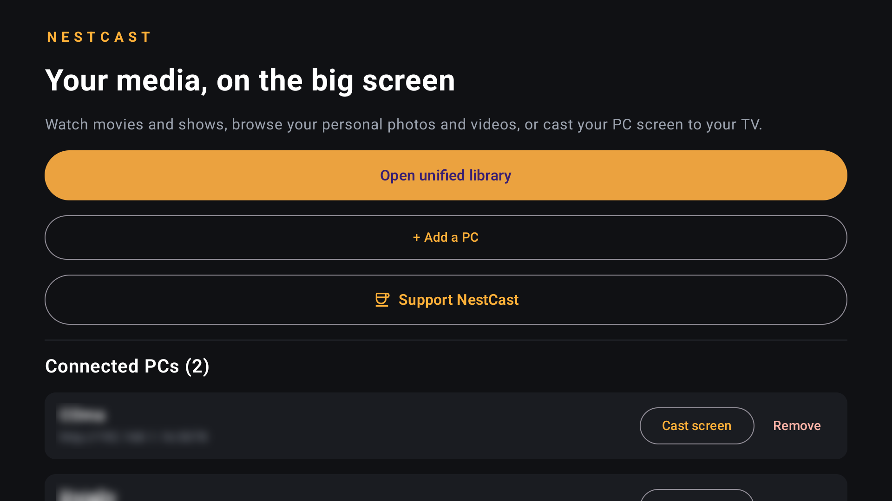
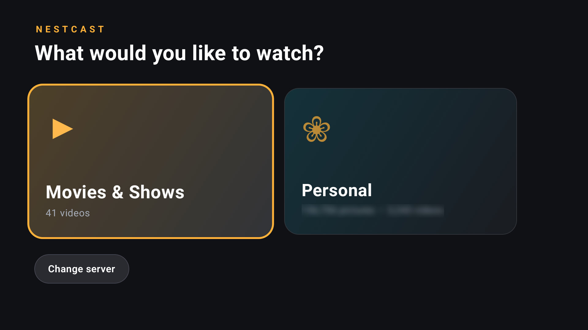
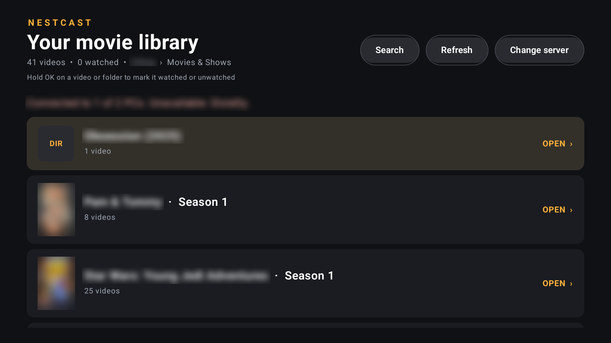

# NestCast TV

NestCast TV turns your Android TV into a big screen for the media on your own Windows PCs. Your videos and pictures stream straight from your PC over your home network: no account, no cloud, no ads.

It works together with **NestCast Server**, a free Windows app that shares the folders you choose. Download it from the [NestCast Server releases](https://github.com/cosmintoncean/castbox-media-server/releases/latest).

## Screenshots

## Features

- **One library from several PCs.** Add one or more PCs and browse their movies and shows together.
- **Pick up where you left off.** NestCast remembers how far you got in each video and shows what you have watched.
- **Next episode.** Near the end of an episode, a button starts the next one and marks the current one as watched.
- **Posters for your shows**, found automatically from folder names.
- **Personal pictures and videos.** Browse your own photo and video folders in a separate section, with a full-screen photo viewer. Large collections open quickly.
- **Cast your PC screen** to the TV, with sound. Your PC asks for permission before anything is shared.
- **Who's watching?** Optional profiles for a shared TV when more than one person tracks their viewing with MediaLog.
- **Made for the remote.** Everything works with the D-pad and OK button.

## Requirements

- An Android TV or Google TV device running Android 6.0 or newer (including Chromecast with Google TV).
- A Windows PC running NestCast Server, on the same home network as the TV.

## Download

Get the latest APK from the [Releases page](https://github.com/cosmintoncean/nestcast-tv-android/releases/latest) (`NestCast-TV-<version>.apk`) and install it on your TV:

1. Copy the APK to the TV (a USB drive, or a file manager app that can fetch it), or install it from a computer with `adb install`.
2. Allow your file manager to install apps from unknown sources when Android asks.
3. Open the APK and install it. Later releases install over the previous one and keep your settings.

This APK is not the Google Play build. If you install NestCast from Google Play, update it there instead; the two can't replace each other.

## Connecting to your PC

1. Install and start **NestCast Server** on your PC and add the folders you want to share.
2. The server window shows a connection address such as `http://192.168.1.25:5078`.
3. On the TV, open **NestCast** and choose **+ Add a PC**. The address field starts with a likely address; change the last digits to match, and give the PC a name.
4. Choose **Open unified library** and pick something to watch.

Use **Refresh** after adding or removing files, or when a PC comes back online. If the TV can't reach the PC, allow NestCast through the Windows firewall (the server has a **Configure firewall** button).

## Known limitations

- PCs are added by typing their address; there is no automatic discovery yet.
- Playback depends on what your TV can decode. Many MKV files work, but a container alone doesn't guarantee it. There is no transcoding. NestCast includes a software decoder for common audio formats such as Dolby Digital Plus, AC-3 and DTS.
- The server has no password. Use it only on a trusted home network and never expose it to the internet.
- The server is Windows only.

## Privacy

NestCast collects nothing. See the [privacy policy](PRIVACY.md).

## Licence

NestCast TV is free software under the [GNU General Public License v3.0](LICENSE). It includes the Jellyfin FFmpeg audio decoder for Media3 (GPL-3.0), which is why the whole app is GPL-3.0 and its source stays available. Other libraries (AndroidX, Media3, Coil, ZXing) are Apache-2.0.

## For developers

Build instructions, the server API and development notes are in [docs/DEVELOPMENT.md](docs/DEVELOPMENT.md).
